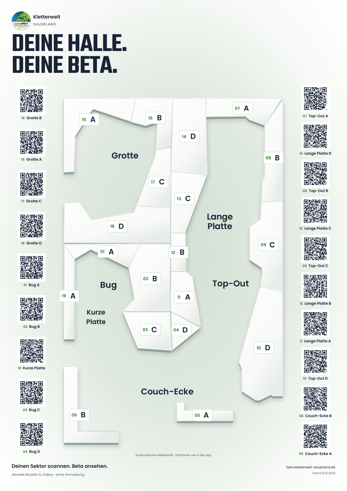

# Kletterwelt Sauerland: A3-Sektorenplakat



## Druckdateien

- **kws-sektoren-a3.pdf**: 297 × 420 mm, A3 hochkant, eine Seite.
- **kws-sektoren-a3-beschnitt.pdf**: 303 × 426 mm, 3 mm Beschnitt pro Seite;
  PDF-TrimBox auf 297 × 420 mm. Hintergrund bis zum Rand, keine Schnittmarken.
- **kws-sektoren-a3.html**: vollständig eigenständige, editierbare Vorlage mit
  eingebetteten Fonts, Logo und SVG-QR-Codes. Kein CDN und keine Trackingdienste.
- **hall-map.svg**: editierbare schematische Kartenzeichnung; Poppins als Schrift.

In Originalgröße (100 %) drucken, nicht „An Seite anpassen“. QR-Codes sind
24 mm groß und besitzen eine vier Module breite weiße Ruhezone. Ein Probedruck
mit dem tatsächlich eingesetzten Papier und Handy ist vor der Auflage nötig.
Keine Logos, Farben oder Dekorationen in die QR-Codes setzen.

Die PDF enthält Vektortext und Vektor-QR-Codes, eingebettete Teko-/Poppins-Fonts
und das Original-KWS-Logo. Ausgabe in RGB. Falls die Druckerei CMYK verlangt,
mit ihrem konkreten ICC-Profil konvertieren und das KWS-Grün erneut prüfen.
Es wird keine beliebige CMYK-Konvertierung als verbindliche Markenfarbe ausgegeben.

## Inhalt und Quellen

Am 13.10.2026 ausschließlich per öffentlichem GET aus der laufenden KWS-App
gelesen: 19 physische Sektoren, 19 Kartenpolygone, eine aktive Karte. Die gemeinsame
`resolveSectorArea`-/`groupSectorsByArea`-Logik liefert sechs Hauptbereiche und
19 öffentliche Teilbereiche. `Kurze Platte` ist separat von `Bug A`; die
technische Altzuordnung von Felsenmeer wird wie in der App korrigiert.

Die Kartenpunkte und Tag-Anker sind unverändert aus der aktiven Karte abgeleitet.
Nur die Ansicht ist um 90° im Uhrzeigersinn gedreht. Weiße Wände, graugrüner Boden,
dunkelblaue Schrift und originaler KWS-Akzent `#36B531` folgen dem App-Design.
Schematische Tiefe, keine Vermessung, kein Fluchtweg-/Sicherheitsplan.

Revision 2 ersetzt die vom Nutzer abgelehnte QR-Tabelle: hochkant, freistehende
Karte in der Mitte, QR-Codes in zwei schmalen seitlichen Spalten, nach ihrer
ungefähren vertikalen Kartenposition geordnet. Keine Tabellenlinien oder
zusätzlichen Gruppen-Nummern. Kleine Zuordnungsnummern 01–19 verbinden jede
Wandmarkierung eindeutig mit ihrem QR-Namen; keine neuen Sektor-IDs. Öffentliche Namen unter jedem QR-Code; Bereichsnamen
im Kartenboden und A–D direkt an den unveränderten Polygonankern. Hintergrund
und räumliche Wanddarstellung folgen dem freigegebenen App-Kartenentwurf.

Jeder QR-Code verwendet die bestehende Route:

`https://beta.kletterwelt-sauerland.de/guest?sector=<öffentlicher Name>`

Gast- und angemeldete App lösen diese Namen in den bestehenden Sektorfilter auf.
Keine Kurzlink-Anbieter oder localhost-Adressen. Öffentliche QR-Ziele und
Kartenpositionen stehen nachvollziehbar in `qr-manifest.json`; die minimale,
öffentliche Quelldaten-Momentaufnahme steht in `sectors-source.json`.
Es werden keinerlei Schlüssel, Nutzer-, Auth- oder Betriebsdaten gespeichert.

## Reproduktion

Benötigt die bereits im Projekt vorhandenen Node-Pakete `qrcode`, `typescript`,
`playwright`, `sharp`, Chromium sowie Python `pypdf` und Poppler `pdftoppm`.
Keine zusätzliche App-Abhängigkeit. Mit den vorhandenen Workspace-Runtimes:

```powershell
# Ohne --capture bleibt die dokumentierte Momentaufnahme reproduzierbar.
node scripts/generate-sector-poster.mjs
python scripts/finalize-sector-poster.py
pdftoppm -r 300 -png -singlefile docs/print/sectors/kws-sektoren-a3.pdf tmp/pdfs/sector-poster-300
node scripts/verify-sector-poster-qr.mjs
pdftoppm -scale-to 1800 -png -singlefile docs/print/sectors/kws-sektoren-a3.pdf docs/print/sectors/kws-sektoren-a3-preview
```

`--capture` aktualisiert vorher die öffentliche Quelle; keine Schreibzugriffe auf
die App. Es extrahiert die öffentliche Lesekonfiguration zur Laufzeit aus dem
Produktionsbundle und verwirft sie wieder. Ändert sich das Produktionsformat,
bricht es ab. Nach geänderter Sektorenanzahl ist bewusst ein Layoutreview nötig.

Wenn das isolierte Plakat-Worktree keine eigenen node_modules besitzt, darf
`KWS_POSTER_PACKAGE_ROOT` auf einen bestehenden Projektcheckout mit diesen
Paketen gesetzt werden. Dieser Pfad bleibt lokal, nicht in der Vorlage.
Generatoränderungen erfolgen im Skript und `scripts/sector-poster.css`, anschließend neu rendern; direkte
HTML-Korrekturen bleiben editierbar, werden aber beim Generieren überschrieben.

## QA am 13.10.2026

- Der erste Entwurf wurde vom Nutzer abgelehnt und in Revision 2 komplett
  neu komponiert. Visuelle Prüfungen erfolgen anhand der finalen PDF-Rasteransicht.
- Unabhängige Brief-/System-/Craft-Kritik mit eigener Referenz und sichtbarem
  Maßstab (`bar.md`, `design-system.md`); Ergebnisse in `design-loop.md`.
- Eine Seite; exakte A3-/Beschnittmaße und eingebettete Fonts geprüft.
- Alle 19 öffentlichen Namen und 19 richtigen, eindeutigen PDF-Linkziele geprüft.
- 34.347 Modulpositionen der tatsächlich bei 300 DPI gerenderten PDF gegen die
  QR-Matrizen einschließlich Ruhezone verglichen; alle stimmen.
- Generator prüft Polygone, vorhandene Tag-Anker, Layoutgrenzen, separaten
  Bug-A-/Kurze-Platte-Eintrag und korrekte URL-Parameter.
- JavaScript-Syntax und `git diff --check` bestanden.
- Noch kein physischer Probedruck und kein Scan eines gedruckten Exemplars.

Nur Plakatdateien und Reproduktionsskripte gehören zu diesem Branch.
Keine App-Funktionen geändert und keine Web-/Native-Veröffentlichung ausgelöst.
