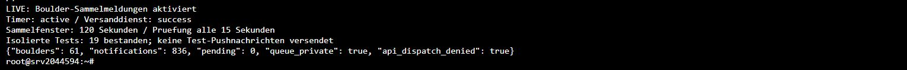
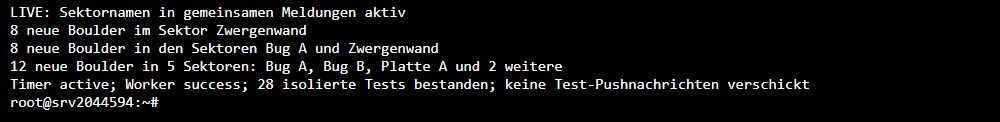

# Joint Boulder notifications — production verified

The eight serial uploads on 13 October each took more than ten seconds, so the
previous ten-second notification grouping produced eight immediate pushes.

Ready callbacks now enqueue a private, deduplicated Boulder event. A local
worker publishes one final notification per eligible recipient when no Boulder
has become ready for two minutes and recent uploads or video jobs are no longer
active. The existing push trigger sends the final message, for example
`8 neue Boulder im Sektor Zwergenwand`. Single uploads retain singular text.
In-app notifications are grouped at the same point; they no longer appear once
for every intermediate callback.

This is compatible with the installed Android migration APK and existing iOS
clients. Those clients do not provide a shared batch ID, so grouping uses hall
activity: nearby separate uploads can join the same message. A pause longer
than two minutes with no active transfer/job starts a new group. Abandoned
uploads stop holding delivery after thirty minutes without status activity.

## Verification on 14 October 2026

- Nineteen checks passed in an isolated PostgreSQL database, including the exact
  eight-upload regression, processing/compression delays, preference exclusions,
  repeated callbacks, two concurrent workers, rollback/retry, single uploads,
  hidden Boulders and access by the actual local worker role.
- Push delivery was replaced with a local recorder in the isolated fixture;
  no real test notifications were sent. The disposable database was removed.
- Installation uses the existing local `supabase_admin` migration role because
  the restored `postgres` role cannot create objects in the public schema.
  The private queue has RLS and no app-role privileges. Only the trusted local
  worker role receives execution rights for the dispatch function.
- The migration is active on production `postgres` at `srv2044594`.
  `kws-boulder-notifications.timer` is enabled and active; the service result is
  `success`. It checks every fifteen seconds and runs without exposing tokens
  or provider credentials in its logs.
- After installation: 61 Boulders and 836 previous notifications retained;
  pending queue empty. Existing notifications were not replayed.
- Live device receipt of a newly grouped production upload has not been tested;
  observe the next ordinary batch instead of sending synthetic pushes to users.

## Operation

Worker: `/opt/kws/tools/flush-boulder-notifications.py`.
Verification report: `/opt/kws/production/BOULDER-NOTIFICATIONS-VERIFIED.json`.
The previous trigger function is retained at the `previous_function` path in
that report. No source-cloud access or firewall rule was changed; installation
used the existing authenticated Hostinger web console when the laptop's new IP
could not reach SSH.

For rollback, stop the timer first and inspect pending queue entries before
restoring the saved function. Preserve those entries and account for unsent
events; restoring the old function resumes the previous immediate delivery.
The original trigger function owner was `postgres`; restore that ownership if
returning fully to the previous permission model.

The self-hosted database has no Supabase migration-history table. The migration
is therefore tracked by Git and the protected installation report, rather than
an invented cloud migration entry. Deploying this source does not require a new
web bundle or mobile build.

## Sector labels added on 14 October 2026

Migration `20261014103000_boulder_notification_sector_labels.sql` is now also
active. The final text names one sector, lists two or three with German
conjunctions, and summarizes four or more with the first three alphabetical
names plus the remaining count:

- `8 neue Boulder im Sektor Zwergenwand`
- `8 neue Boulder in den Sektoren Bug A und Zwergenwand`
- `12 neue Boulder in 5 Sektoren: Bug A, Bug B, Platte A und 2 weitere`

Both primary and secondary sector assignments are included while each Boulder
is counted once. Full sector names are retained in `data.sector_names`; the
message alone shortens names exceeding fifty characters and stays within 240
characters. Blank/missing labels use the previous generic message. The private
formatter removes duplicate/blank names and sorts them deterministically.

The expanded isolated PostgreSQL suite passed 28 checks, including actual
eight-Boulder notification payloads with both sector names, singular/plural
wording, long labels, missing labels, deduplication and private function access.
No test pushes were sent to production users. The live timer remains active
and the worker result is `success`. Device receipt still awaits an ordinary
upload. The verification report now records the sector migration digest,
revision, limits and rollback function path.

